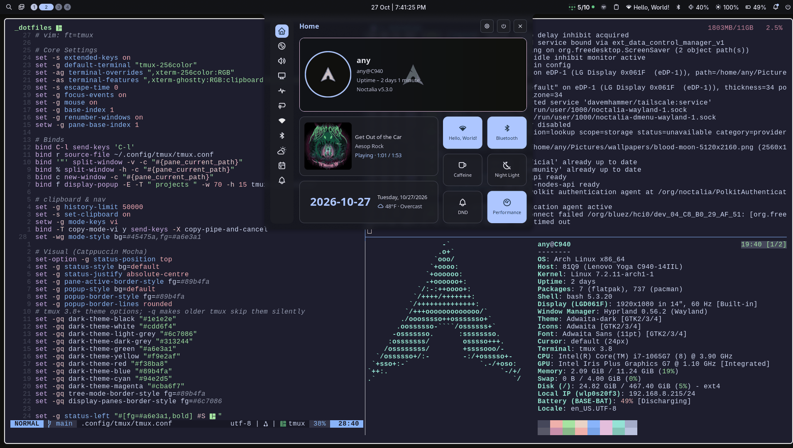

# Dotfiles
My Arch Linux setup, managed with [GNU Stow](https://www.gnu.org/software/stow/).



* **Desktop:** [Hyprland](https://hypr.land/) with [Noctalia](https://docs.noctalia.dev/) for the bar, launcher, and lock screen
* **Terminal:** [Ghostty](https://ghostty.org/) + tmux
* **Editor:** Neovim 0.12, using the built-in `vim.pack`
* **Shell:** bash
* **Tools:** [mise](https://mise.jdx.dev/) for language runtimes and CLI tools

## Installation
* Clone
```
git clone git@github.com:justin-gill/dotfiles.git $HOME/.dotfiles
cd $HOME/.dotfiles
```

* pacman packages
```
sudo pacman -S --needed - < $HOME/.dotfiles/pkglist.txt
```

* Config Install
```
mkdir -p $HOME/.local/bin $HOME/Pictures/{screenshots,wallpapers}
stow . --adopt
git restore .
```

* mise tools (node, go, uv, shellcheck)
```
mise install
```

* Flatpak
```
flatpak install -y $(cat $HOME/.dotfiles/flatpaks.txt)
```

### Misc
* Firewall
```
sudo systemctl enable --now ufw
sudo ufw enable
```
* Various Services
```
sudo systemctl enable bluetooth
sudo systemctl enable --now tailscaled
sudo tailscale set --operator=$USER
sudo systemctl enable docker.socket
sudo systemctl enable --now paccache.timer
sudo systemctl enable --now systemd-oomd
sudo systemctl enable --now power-profiles-daemon
sudo systemctl enable --now reflector.timer
```

* Firmware updates
```
fwupdmgr refresh && fwupdmgr update
```
* [Paru Install](https://github.com/Morganamilo/paru)
```
rustup default stable # prereq
```

* [tpm](https://github.com/tmux-plugins/tpm) (Use ~/.config/tmux/plugins/tpm)

* Local, untracked overrides
```
$EDITOR ~/.config/git/config.local         # per-machine git overrides, e.g. [user] name/email
$EDITOR ~/.config/mise/mise.local.toml     # per-machine tools
```

* Noctalia Greeter
```
sudo tee /etc/greetd/config.toml >/dev/null <<'EOF'
[terminal]
vt = 1

[default_session]
command = "/usr/bin/noctalia-greeter-session"
user = "greeter"
EOF
sudo systemctl enable greetd
```

* Noctalia Plugins (run with noctalia running)
```
noctalia msg plugins enable davemhammer/tailscale
```

Ubuntu: see [UBUNTU.md](UBUNTU.md).
